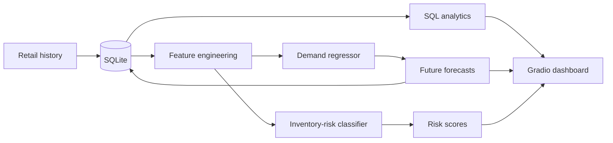
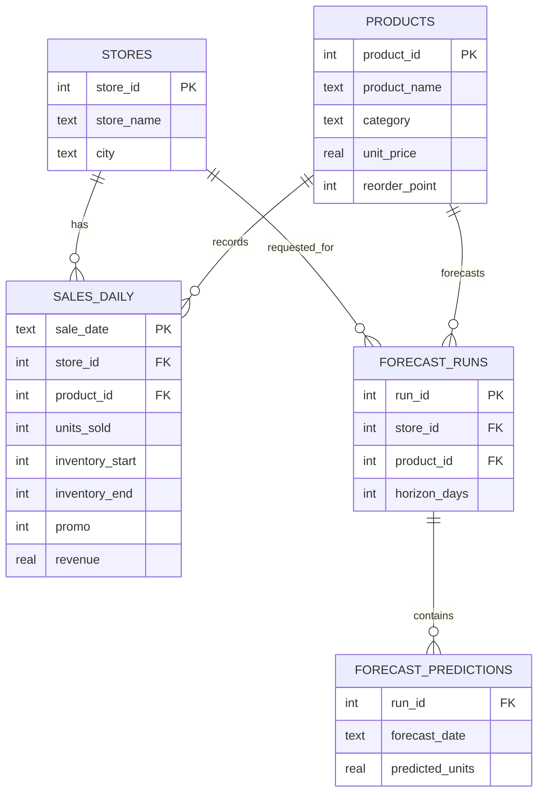

# RetailAI SQL — Demand Forecasting & Inventory Intelligence

A fully local portfolio project combining **machine learning, SQL analytics, time-series feature engineering, inventory-risk prediction, and a Gradio dashboard**.

The repository ships with a deterministic synthetic retail dataset, a normalized SQLite database, trained ML artifacts, reproducible training code, and an interactive app. No API keys or external database server are required.


## What it demonstrates

- **SQL:** relational schema, joins, CTEs, aggregations, indexes, views and window functions.
- **ML regression:** next-day/item demand modeling with lag, rolling, promotion, calendar, product and store features.
- **ML classification:** inventory-risk prediction from historical demand and stock state.
- **Model evaluation:** chronological holdout instead of random shuffling for a more realistic forecasting test.
- **Persistence:** every generated forecast is written back to SQLite in `forecast_runs` and `forecast_predictions`.
- **Productization:** a Gradio interface with analytics, forecast scenarios, risk scoring, SQL exploration and model results.

## Trained results

Models were trained on **36,720 feature rows** and evaluated on a **5,460-row chronological 90-day holdout** beginning 2025-10-02.

| Task | Selected model | Key results |
|---|---|---|
| Demand forecasting | HistGradientBoostingRegressor | **MAE 1.16 units/day**, RMSE 1.60, **R² 0.918**, MAPE 12.8% |
| Inventory risk | HistGradientBoostingClassifier | Accuracy 96.7%, Precision 95.7%, Recall 93.5%, **F1 0.946**, **ROC-AUC 0.996** |


> The bundled dataset is synthetic by design. It models store/product demand differences, weekly and annual seasonality, category-specific demand, promotions, inventory replenishment and occasional supplier delays. This keeps the repository reproducible and avoids presenting proprietary data as public data.

## Application

The Gradio UI contains five tabs:

1. **Executive Dashboard** — revenue, units, stockouts, category performance and top products.
2. **Demand Forecast** — choose a store/product, 7–30 day horizon and promotion scenario; the forecast is saved back to SQL.
3. **Inventory Risk** — ML risk probabilities, reorder points and days-of-cover indicators.
4. **SQL Explorer** — read-only queries against the live SQLite database with examples using joins, CTEs and window functions.
5. **Model & Data** — model comparison, holdout metrics and feature importance.

## Architecture



## Database schema



## Run locally

### Windows
Double-click:

```text
run_windows.bat
```

### macOS / Linux

```bash
chmod +x run.sh
./run.sh
```

Or manually:

```bash
python -m venv .venv
# Windows: .venv\Scripts\activate
# macOS/Linux: source .venv/bin/activate
pip install -r requirements.txt
python app.py
```

The app opens on localhost in your browser.

## Reproduce the training pipeline

The repository already includes the trained artifacts. To regenerate the database and train both models from scratch:

```bash
python scripts/build_project_data.py
```

That script:

1. Generates two years of deterministic synthetic daily retail data.
2. Creates lag and rolling-demand features.
3. Uses the final 90 days as a chronological holdout.
4. Compares HistGradientBoosting vs RandomForest for demand regression.
5. Compares HistGradientBoosting vs Logistic Regression for inventory-risk classification.
6. Saves the best models with `joblib`.
7. Stores training metrics in both JSON and SQLite.
8. Rebuilds the SQLite database and README assets.

## SQL examples

`sql/analytics.sql` contains standalone examples. The application also exposes a safe read-only SQL Explorer. Example:

```sql
WITH daily AS (
    SELECT sale_date, SUM(units_sold) AS units
    FROM sales_daily
    GROUP BY sale_date
)
SELECT sale_date,
       units,
       ROUND(AVG(units) OVER (
           ORDER BY sale_date
           ROWS BETWEEN 6 PRECEDING AND CURRENT ROW
       ), 2) AS rolling_7d_units
FROM daily;
```

## Repository structure

```text
RetailAI-SQL/
├── app.py
├── retail_ai/
│   ├── db.py
│   └── ml.py
├── data/
│   ├── retail_ai.db
│   ├── sales_daily.csv
│   └── feature_importance.csv
├── models/
│   ├── demand_forecaster.joblib
│   ├── inventory_risk_classifier.joblib
│   └── metadata.json
├── scripts/
│   └── build_project_data.py
├── sql/
│   ├── schema.sql
│   └── analytics.sql
├── assets/
├── tests/
├── .github/workflows/ci.yml
├── requirements.txt
├── run_windows.bat
├── run.sh
└── README.md
```

## Interview talking points

- Why a chronological split matters for time-dependent data.
- How lag/rolling features convert time-series behavior into a supervised regression problem.
- Why SQL remains useful even when the predictive layer is Python/ML.
- How predictions are persisted back into operational tables instead of existing only in memory.
- Difference between forecast error metrics (MAE/RMSE/MAPE/R²) and classification metrics (precision/recall/F1/ROC-AUC).
- Why the SQL Explorer is read-only.
- How this prototype could migrate from SQLite to PostgreSQL and scheduled batch inference in production.

For detailed training/validation notes, see [`MODEL_CARD.md`](MODEL_CARD.md).

## Disclaimer

This is a portfolio/demo analytics system trained on synthetic retail data. Forecasts and inventory-risk scores are not intended for real purchasing decisions without validation on real business data.

## License

MIT
